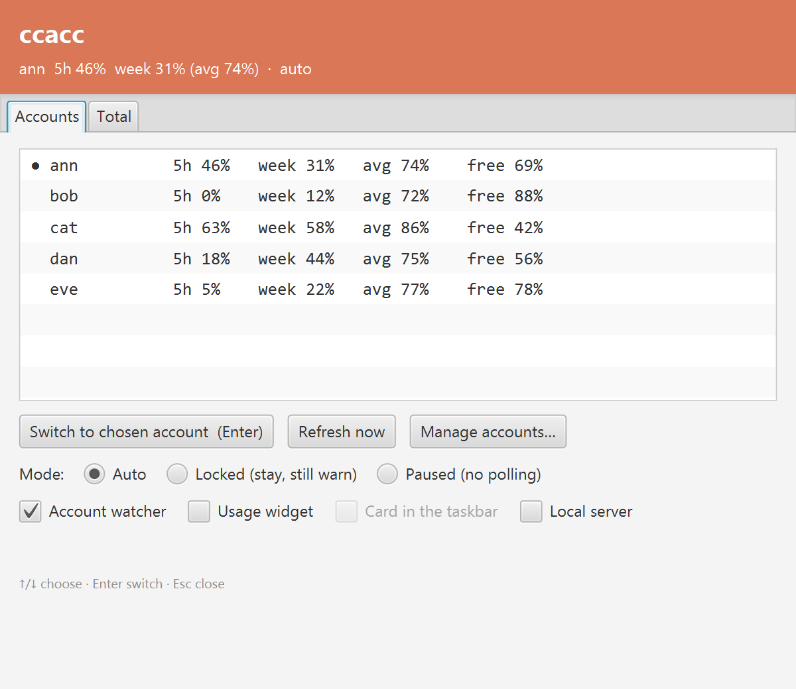
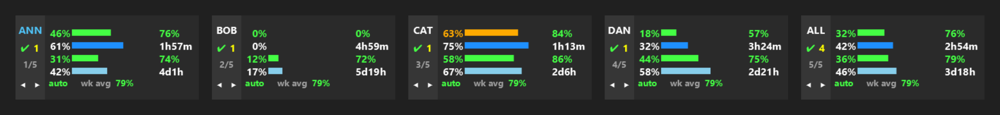
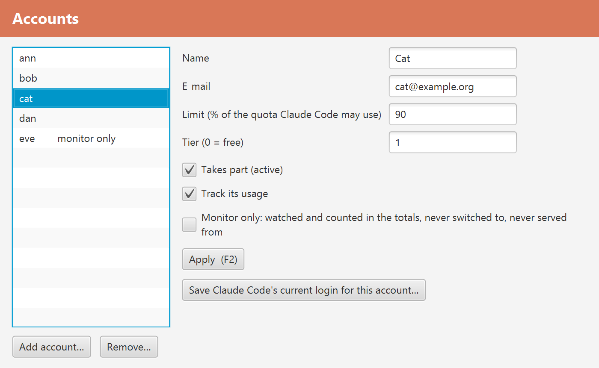

# ccsuite

Tools for people who use Claude Code with more than one Claude subscription. The main one is **ccacc**.

## ccacc

ccacc shows how much of each account's 5-hour and weekly quota is used, and moves Claude Code to the account with the most room, either when you ask or on its own. It sits in the tray (Windows) or the menu bar (macOS) and keeps out of the way.

What it does:

- Shows the 5-hour use, the weekly use, the weekly pace (use divided by time gone: 100% spends the week exactly as it passes) and what is free, for every account, and the same added up over all of them.
- Switches Claude Code to another account in one click, or with `ccacc switch <id>`. A switch you make is respected: automatic rebalancing waits half an hour before moving you again.
- Has three modes. **Auto** moves Claude Code when an account runs out and rebalances toward the account with the most room. **Locked** never moves it, but still warns you when the account nears its limit. **Paused** does not even poll.
- Lets you give each account a limit (the share of its quota Claude Code may use), and mark an account **monitor only**: it is watched and counted in the totals, but never switched to.
- Protects accounts that someone else relies on. In Auto mode, once an account has used more than half of its 5-hour quota, faster than the 5 hours pass, Claude Code moves off it, and no move sends load onto an account past that line. Mark your own accounts **primary** to exempt them.
- Does not waste a week's quota. Quota left unused when a week resets is lost, so in its last 24 hours an account is used up first: a primary account to 100%, any other up to its own limit.
- Windows only: a small card in the taskbar, one account at a time, with the active account's name glowing, red when you are spending too fast.
- Can run a local proxy on the machine (what `ccls` did). It is off until you turn it on with `ccacc part server on`.
- Two local lanes for Claude Code, each on its own port and never mixed (`ccacc lanes`). The **paid lane** (port 8681) goes through your paid accounts, every model. The **free lane** (port 8686) goes through your own free claude.ai accounts, Haiku and Sonnet, and works out which free account has the most room for a new conversation; it keeps a chat alive across turns and across a restart of ccacc, measures once an hour what a free window really costs, and tells Claude Code to compact before a conversation outgrows what a free account takes. Start Claude Code on a lane with `pclaude.bat` or `fclaude.bat` (in `ccacc/scripts` of this repository; they leave `claude.exe` and its settings alone). The lanes are off until you run `ccacc lanes on`. The free lane drives claude.ai the way a browser does, which Anthropic can change at any time, so treat it as something that may stop working.
- Shows your free accounts on their own: a tray icon, a window and a second taskbar card for them, and `ccacc free` and `ccacc calls` for what the free lane served and what it cost.
- Gives back the memory of idle Claude Code sessions (Windows): `ccacc trim on` empties the working set of a `claude.exe` that has done nothing for a few minutes, so Windows can use that RAM for something else. It does not end or change a session, it holds back any session that is busy (and, when you use the Tabs terminal, the tab you are looking at), and it is off until you switch it on.
- A local gate on `127.0.0.1` for your own scripts and tools (`ccacc gate`, `ccacc ledger`): a key per caller, the models it may use, a budget in quota points, and a record of every call. It is off until you turn it on with `ccacc part gate on`.

### Install

Windows, in cmd or PowerShell (`curl.exe` ships with Windows 10 and 11):

    curl.exe -fLo ccacc.exe https://github.com/ccsuite/ccsuite/releases/download/v0.1.0-beta.4/ccacc.exe
    .\ccacc.exe install --start-at-login

macOS, in Terminal (one line; `uname -m` picks Apple silicon or Intel):

    curl -fLo /tmp/ccacc https://github.com/ccsuite/ccsuite/releases/download/v0.1.0-beta.4/ccacc-macos-$(uname -m) && chmod +x /tmp/ccacc && /tmp/ccacc -Xjr:yes install --start-at-login

On a Mac with no Java 25, ccacc needs a Java runtime (Eclipse Temurin, about 50 MB) and asks once whether to download it; the `-Xjr:yes` in the line above answers yes for you, which also makes the line work when a program (such as Claude Code) runs it without a terminal. The Mac binary is signed ad hoc, not by an Apple developer. Downloaded with `curl` it opens as it is; downloaded with a browser, macOS asks once (System Settings, Privacy & Security, Open Anyway). The first time ccacc reads Claude Code's login from the Keychain, macOS asks whether to allow it: choose Always Allow.

ccacc is a single file. On first run it fetches its jar from the release, checked against the checksum it carries, and a Java runtime if there is none. Later, `ccacc update` brings it to the newest release. This is a beta: a beta copy follows the beta channel, and a copy that is already on a stable release is never offered a beta.

### What you set up yourself, and what is not shared

ccacc comes with no accounts, no keys and no logins. Everything it works with is yours, set up on your own machine: your own Claude accounts (a paid or free subscription each), a saved login for each, and the settings you choose. Nothing is shared between people: an account is used only by the person who added it, on the machine where it was added, and ccacc has no server of its own that receives your accounts, logins or usage. It talks to Anthropic and claude.ai with your own logins, and to GitHub to look for a newer release.

### Coming from `ccu`, `cswap` or `ccls`

ccacc replaces all three. `ccacc migrate` shows its plan first, then (with `--apply`) retires the old tools: it archives them and never deletes. Until then `ccacc ccu`, `ccacc cswap` and `ccacc ccls` run the old tools with their old options, so nothing you use is lost. After that, add each account to ccacc as under First use.

### First use

ccacc needs to know your accounts and to hold a saved login for each, so that it can switch between them.

1. Add each account: `ccacc account add ann name=Ann email=ann@example.org trackUsage=on`
2. In Claude Code, log in as that account (`claude`, then `/login`).
3. Save that login for it: `ccacc register --id ann`
4. Repeat for every account. `ccacc status` says which one Claude Code is on, `ccacc usage` shows the numbers, and `ccacc` with no arguments starts the app.

`ccacc register` asks Anthropic whose tokens the login really holds and refuses a mixed-up one, so a saved login can never carry another account's tokens under the wrong name.

After a switch, restart Claude Code sessions that were already running. A session started before the switch keeps its old login in memory and can save it back over the new one when it refreshes its token. In Locked mode ccacc warns you when that happens.

### Commands

    ccacc                        the app: tray icon, account watcher, usage widget, local proxy
    ccacc status | list | usage  who Claude Code is on, the accounts, the usage of each
    ccacc tui                    the usage in the terminal
    ccacc switch [id]            switch Claude Code (no id: the next account)
    ccacc mode auto|locked|paused
    ccacc part watch|widget|server|gate on|off
    ccacc account list|add|set|remove
    ccacc register [--id id]     save Claude Code's current login for an account
    ccacc lanes [on|off]         the paid and free lanes and their state
    ccacc free | calls           your free accounts; what the free lane served and cost
    ccacc trim status|on|off|now give back the RAM of idle Claude Code sessions
    ccacc gate | ledger          the local gate for your own tools, and what went through it
    ccacc migrate [--apply]      retire the old ccu, cswap and ccls
    ccacc update                 the newest release

Commands that change something are handed to the running app, so the app is the only writer of everything it holds. With no app running they change the files directly.

### Status

This is a beta.

- Windows: used every day by its author.
- macOS: built and its command line tested on a macOS machine in CI, but the tray icon, the windows and the Keychain access have not yet been tried by a person on a Mac. Claude Code keeps its login in the Keychain on macOS; ccacc reads and writes it there with the system `security` tool, and falls back to the credentials file when there is no Keychain item. Reports from Mac users are welcome.
- The taskbar card, the memory trimmer and the `pclaude.bat` / `fclaude.bat` launchers exist on Windows only.
- The memory trimmer and the free lane's hourly probe have been run by their author on one Windows machine for a few days; the trimmer has not been tried with sessions other than Claude Code's own.
- The free lane depends on how claude.ai behaves today and has no guarantee; the paid lane and everything else use Anthropic's own interfaces.

ccacc only moves your own logins between your own Claude Code sessions on your own machine.

### Files

Everything lives under `~/ccsuite`: the accounts (`base/credentials.json`), the saved logins, the settings (`ccacc/settings.json`) and, while the app runs, the address its command line talks to (`ccacc/control.json`, readable by you only).

## The rest of the suite

ccacc is built from small parts that also run on their own: `ccu` (the usage widget), `cswap` (the account switcher), `ccls` (the local proxy) and `ccd` (downloads a Claude chat from claude.ai). Each module has its own folder and README. The modules that talk to claude.ai through a browser session are a fallback for when the usual channel is unavailable.

## Build from source

Java 25 and Maven. Not possible outside the author's machine yet. Three small libraries of the same author that ccsuite uses (`cdpai-curlimpersonate`, `xyz-jphil-logback-converters`, `xyz-jphil-windows_console_set_unicode_output`) are not on Maven Central yet, so a clean checkout cannot resolve them. And ccacc's free lane is built on a `webproxy` module that sits in a separate repository, which is private for now; its folder goes next to the others (`webproxy/`) and the build picks it up. The released ccacc carries it compiled. Once the libraries and that module are public, this is all it takes:

    mvn package -pl ccacc -am           the jar for the platform you build on, ccacc/target/ccacc.jar
    mvn -Pmac-aarch64 package -pl ccacc -am    a jar for Apple silicon (also -Pmac for Intel, -Pwin for Windows)

JavaFX carries its native libraries per platform, so there is one jar per platform; the profiles above choose which. The launcher executable is built by `jr-maven-plugin`; see `release.ps1`.

## Licence

Apache License 2.0, see `LICENSE`.
